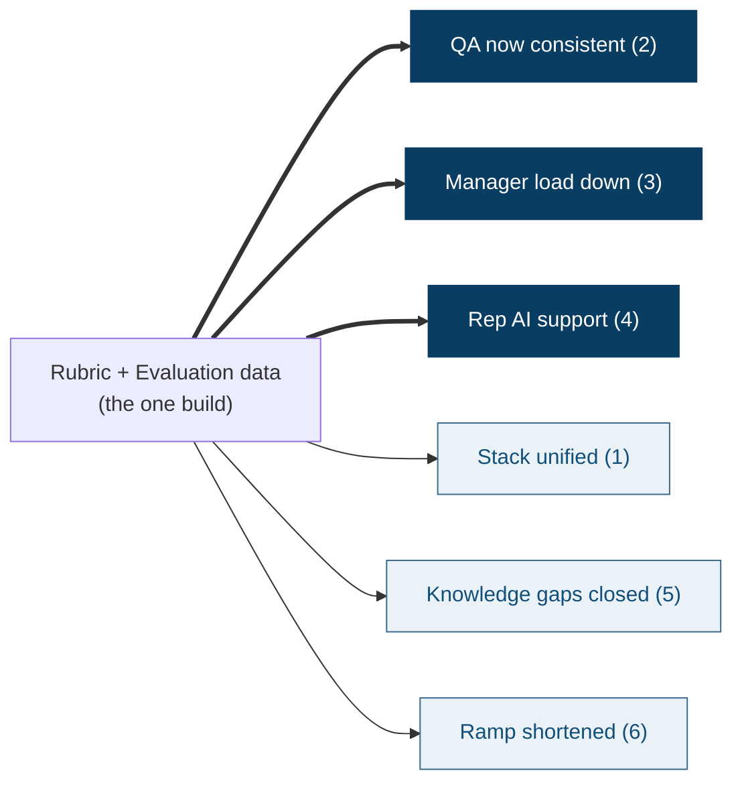

# Phase 1 — Diagnose Before You Build

## Seller Enablement Intelligence

**Janos Kristof** · GTM AI Enablement · *prepared under NDA, call data anonymized*

---

## The stated problem is six pains. The real problem is one.

The brief lists six pains. Treated as a checklist, they invite six half-built fixes. Read as
**symptoms**, they share a single root cause:

> **There is no closed loop that turns each sales call into tracked, improving rep behavior.**

Sensi generates rich behavioral signal on every call — and throws it away. That measurement
vacuum *is* the problem. Fixing it is the leverage point.

---

## I mined every source — then pressure-tested one call

I worked the brief, the GTM deck, the Guide Book, the product/customer materials — and the one
real sales call. That call is **a sample, not a verdict**: it shows the *kind* of gap that goes
uncaught, not that every call looks like this. Anonymized, it shows:

- Rep speaks **~85–90%** of the call — monologue, not discovery
- A **leading close**: *"Would you agree I'm being conservative?"* → *"Yes, because I have
  nothing to disagree."* — compliance, not conviction
- The **biggest fact surfaces by accident at minute 47**: the prospect is *selling his business*
- **No firm next step** booked; manufactured "offer expires this month" urgency

**Today nothing scores any call — so no one knows how common these gaps are. That vacuum is the problem.**

---

## The tell: this call broke Sensi's *own* playbook

Not just weak in the abstract — it departs from Sensi's **own** deck. A scoring loop would catch
this automatically; today nothing does.

- **Motion inverted** — Sensi's deck prescribes *discovery → product → customer story & value*.
  The rep opened with a screen-share, skipped discovery, ran a DIY ROI calculator.
- **Invented numbers instead of Sensi's published proof:**

| Rep said (this call) | Sensi actually publishes |
|----------------------|--------------------------|
| "$623K, unbelievably conservative" | ~$500K avg savings — the rep *overshoots* the official figure |
| "3.3 months LoS, 1,000-agency survey" | "2× length of stay"; no such survey exists |
| "Sally = 3–4× a salesperson" | "your entire inside sales force in one agent" |

**The point isn't that every rep does this — it's that nothing measures whether *any* call uses Sensi's own motion and proof.**

---

## Before building, I'd confirm — not assume

- **Interview map, in order:** Ops leadership → VP Sales → 3 reps (top / ramping / struggling)
  → 1–2 managers → RevOps/HubSpot owner → onboarding → product marketing
- **Sample, don't assume:** score **15–20 recent calls across 3 rep tiers** — I would *not*
  treat one call as representative
- **Data I'd pull:** win/loss by rep & stage, ramp cohorts, existing Jiminny analytics, call
  coverage, stage-conversion leaks
- **Verified, not assumed:** CRM = **HubSpot** (confirmed) — a real integration + a no-new-tool
  routing option

---

## One build moves the most pains

**Thick arrows** = directly solved · **thin arrows** = unlocked. Same two artifacts power all six.

---

## The bet I'm taking into Phase 2

> **Biggest leverage point: an automated post-call evaluation + coaching loop.**

**Why I believe it**

- The gap is real *and invisible* — nothing measures it, so the loop turns an unknown into a managed number
- It's the **cheapest place to install measurement** — it *creates* the baseline from call one
- It attacks the binding constraint — **manager capacity**
- It **compounds**: the same loop later templates onto onboarding, CS, any team

**What I'd build to test it →** the *Rep Coach* scorecard (Phase 2).

---

## Falsifiable — I'd rather be wrong in week 2 than month 6

- Reps don't return to it → feedback isn't actionable enough
- Scores don't move behavior in ~3–4 weeks → the rubric measures the wrong things
- Managers don't trust the scores → evidence/explainability too thin

Each has a leading metric in the Phase 2 tool. **Next: build the thing that runs.**
