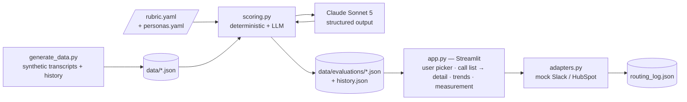
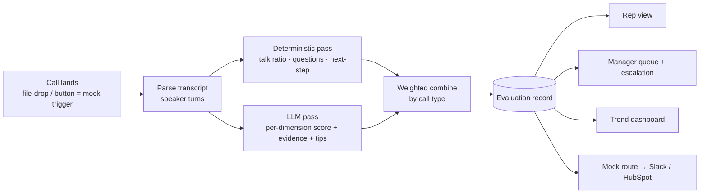
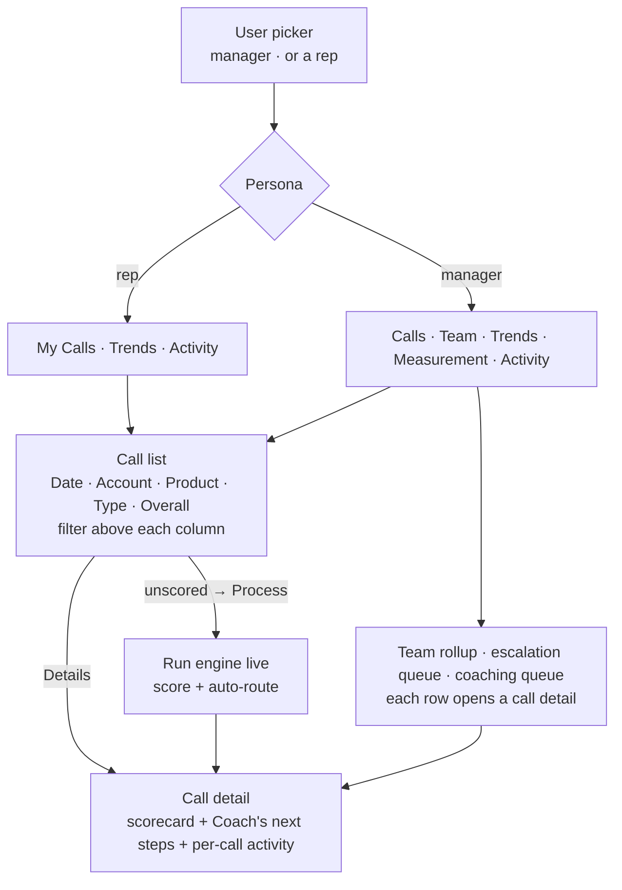

# Rep Coach — System & Product Design

**Phase 2 · Build** · Janos Kristof · *produced before writing app code*

This is the design the agentic build loop implements against. Diagrams here are the **source** for
the architecture/process-flow visuals reused in the capstone deck. Scope and acceptance live in
`prd.md`; the make-vs-buy stance in `make_vs_buy.md`.

---

## 1. System architecture



**Design intent:** capture/transcription is *bought* (a transcript comes in); Rep Coach is the
**loop on top**. The scoring core is pure Python + a single structured LLM call, so it's testable
and CI-tool-agnostic. The UI reads pre-computed evaluations for a stable demo and can re-score one
call live.

### File layout (`build/`)
```
app.py            Streamlit UI (user picker → call list → detail · trends · measurement · activity · routing)
scoring.py        deterministic metrics + LLM scoring + weighted combine (rubric-driven)
rubric.yaml       call-type-aware dimensions & weights (versioned)  ← the templatable seam
rubric_csqa.yaml  Phase-3 CS-QA variant (proves AC8: no code change)
personas.yaml     5 rep archetypes + manager · products · call types
generate_data.py  builds synthetic transcripts + seeded history (fixed seed, baked dates)
adapters.py       Notifier / CRM interfaces + mock implementations + activity seeding
verify_ac8.py     templating proof: same engine scores a support call via rubric_csqa.yaml
verify_ui.py      Playwright end-to-end UI check (fresh server per view, screenshots)
data/
  synthetic/*.json    12–15 speaker-labeled transcripts + 1 anonymized real call
  evaluations/*.json  pre-computed evaluation records (seed the views)
  history.json        ~6–8 weeks of seeded score-summaries for the dashboards
  routing_log.json    mock Slack/HubSpot sink
requirements.txt · .env.example (ANTHROPIC_API_KEY; real .env gitignored)
```

---

## 2. Post-call process flow



---

## 3. Data model

**Transcript** (`data/synthetic/<call_id>.json`)
```json
{
  "call_id": "R3_disc_014",
  "rep_id": "R3", "product": "Sally", "call_type": "discovery",
  "date": "2026-05-18", "duration_min": 42,
  "turns": [
    {"speaker": "Rep", "text": "..."},
    {"speaker": "Prospect", "text": "..."}
  ]
}
```

**Evaluation record** (`data/evaluations/<call_id>.json`)
```json
{
  "call_id": "R3_disc_014", "rep_id": "R3", "product": "Sally",
  "call_type": "discovery", "date": "2026-05-18",
  "rubric_version": "1.0.0", "model": "claude-sonnet-5",
  "overall": 58,
  "deterministic": {"talk_ratio": 0.86, "rep_questions": 3, "open_questions": 1,
                    "next_step_booked": false, "monologue_max_words": 640},
  "dimensions": [
    {"key": "discovery_quality", "score": 2, "weight": 0.22, "signal": "hybrid",
     "evidence": ["\"Any questions from our first conversation?\" → \"I don't have any.\""],
     "tip": "Open with 2–3 fresh discovery questions before any screen-share."}
  ],
  "flags": [{"type": "manufactured_urgency",
             "evidence": ["\"valid until the end of the month\""]}],
  "recommendations": [{"title": "Discovery-first opening (Sally)", "why": "Talk ratio 86%; no fresh discovery"}],
  "generated_at": "2026-05-18"
}
```

**History record** (`data/history.json`, seeded — no transcript, cheap depth for trends)
```json
{"rep_id": "R5", "date": "2026-04-06", "call_type": "demo_close",
 "product": "Olly", "overall": 71,
 "dimensions": {"discovery_quality": 3, "proof_fidelity": 4, "next_step": 4}}
```

**Rubric** (`rubric.yaml`) — see §4.

---

## 4. Rubric & scoring pipeline

The rubric encodes what a good Sensi call looks like, drawn straight from the Phase-1 diagnosis
(the real call's failure modes) and Sensi's **own** prescribed motion + published proof wall.

| Dimension | What it measures | Signal | disc / demo / follow weight |
|-----------|------------------|--------|-----------------------------|
| **motion_adherence** | Followed Sensi's motion (discovery → product → value) for this call type | LLM | 0.15 / 0.15 / 0.10 |
| **discovery_quality** | Fresh, open discovery vs. assumptions / leading questions | hybrid | 0.22 / 0.10 / 0.12 |
| **talk_listen_balance** | Rep vs. prospect airtime (monologue penalty) | deterministic | 0.13 / 0.10 / 0.10 |
| **buying_signal** | Detected *and* qualified buying/risk signals | LLM | 0.15 / 0.12 / 0.16 |
| **objection_handling** | Surfaced, acknowledged, resolved objections | LLM | 0.10 / 0.15 / 0.16 |
| **proof_fidelity** | Claims match Sensi's published proof; no invented numbers | LLM | 0.10 / 0.20 / 0.10 |
| **next_step** | Firm, dated next commitment booked | hybrid | 0.15 / 0.18 / 0.26 |
| **authenticity_flags** | Manufactured urgency / false-agreement (negative) | LLM flag | penalty / penalty / penalty |

*Scores are 0–5 per dimension; overall = weighted sum rescaled to 0–100. Weights are per call type
and live in `rubric.yaml`; `authenticity_flags` applies a capped penalty rather than a weight.*

**Deterministic pass (in code — not an LLM guess):**
- `talk_ratio` = rep_words / total_words → mapped to a 0–5 score (band: ~0.4–0.55 ideal for
  discovery → 5; > 0.8 monologue → ≤ 2).
- `rep_questions` / `open_questions` — count `?` in rep turns; open = starts with
  what/how/why/tell me/walk me/what if.
- `next_step_booked` — regex for a scheduled, dated commitment ("let's meet", a weekday, a date).
- `monologue_max_words` — longest single rep turn (feeds the talk-balance narrative).

**LLM pass (one structured call):** Claude receives the rubric definitions, **Sensi's prescribed
motion**, **Sensi's published proof wall** (the real numbers, so it can catch invented ones), and
the transcript. It returns **only** the LLM/hybrid dimensions with `score`, **verbatim `evidence`
quotes**, and a concrete `tip`, plus `flags` and `recommendations`. Structured output is enforced
via Anthropic **tool-use** (a single `submit_evaluation` tool whose input schema is the record) so
the return is always valid JSON — the model retries on schema mismatch.

**Combine:** deterministic dimensions get their computed 0–5 score; hybrid dimensions blend the
computed signal with the LLM score (e.g. `discovery_quality` = mean(open-question score, LLM
score)); overall = weighted sum by call type, minus flag penalties, rescaled to 0–100.

### Prompt shape (documented for reproducibility)
```
SYSTEM: You are a senior {rubric.evaluator_role} evaluator for Sensi (Care Intelligence for senior
        care).  ← role, motion, proof wall, and the flag set are all read from the rubric, so the
        same prompt scaffold serves sales or CS-QA (see AC8). Score only against the rubric. Cite
        VERBATIM quotes from the transcript as evidence for every score. Be calibrated: a monologue
        with no discovery is a 2, not a 4. Flag the rubric's authenticity flags. Recommend Sensi
        micro-content.  Sensi's prescribed motion: <rubric.motion>. Published proof wall: <rubric.proof_wall>.
USER:   <rubric dimensions + call_type weights> + <transcript turns>
TOOL:   submit_evaluation(dimensions[], flags[], recommendations[], summary)   ← schema-enforced
```

---

## 5. UX flows (wireframe-level)

A single **user picker** at the top drives the whole app — pick a **rep** → that rep's own tabs;
pick the **manager** → team tabs across everyone. The core interaction is **call list → call
detail** (no sidebar).



- **Call list** — Date · Account · Product · Type · **Overall** (unscored → "—"), with a filter
  control sitting directly above each column; a per-row **Details** button opens the detail (or
  **⚡ Process** for an unscored call). The manager's list adds a **Rep** column and spans all reps.
- **Call detail** — the visual **scorecard** (per-dimension score chips + inline evidence + tips),
  an **overall summary**, **Coach's next steps** (top-2 focus fixes + tips merged with recommended
  micro-content), the full transcript, and the **per-call integration activity** (the routed
  Slack/HubSpot actions for *this* call — the prototype view of the HubSpot activity timeline).
- **Process (unscored)** — the ⚡ button runs the real engine end-to-end and **auto-routes** the
  coaching loop; results persist in session only, so the committed dataset stays reproducible. This
  is the manual stand-in for production's automated post-call trigger.
- **Team (manager)** — sortable rollup; the escalation queue auto-flags calls where a core
  dimension is very low or a flag fired; the coaching queue ranks reps. Every entry **drills into
  the call detail**.
- **Trends** — line charts from `history.json` with a metric selector (Overall + each dimension);
  the five archetypes make the story legible (R1 benchmark, R3 ramp, R4 plateau, R5 improvement).
- **Measurement** — leading vs. lagging metrics (from `prd.md` §6), split into "computed from
  evaluations today" vs. "wired to product telemetry in production," with the honest baseline note.
- **Activity** — a filterable feed of every routed action (endpoint · type · rep · product ·
  account · call · timestamp · content) from `routing_log.json`; each synthetic call carries an
  `account` (a home-care agency) so actions are attributable.

---

## 6. Interface contracts (the production seam)

Routing lives behind narrow interfaces so the production swap is an adapter/config change, not a
rewrite — the same seam that becomes **HubSpot as the single surface** in production.

```python
class Notifier(Protocol):
    def send_nudge(self, rep_id: str, message: str, link: str) -> None: ...

class CRM(Protocol):
    def create_task(self, owner: str, title: str, due: str, related_to: str) -> str: ...
    def attach_scorecard(self, call_id: str, evaluation: dict) -> None: ...
```

- **Prototype impls** (`MockNotifier`, `MockCRM`) append to `routing_log.json` and surface in the
  UI — proving the loop *routes*.
- **Production impls** (documented, not built here) — `SlackNotifier`, `HubSpotCRM` (UI Extension
  card on the call record + Workflows-routed tasks). Selected by config; **the core never changes.**

---

## 7. Synthetic dataset design (`generate_data.py`, `personas.yaml`)

- **5 rep archetypes** → a dashboard story: **R1** top/stable (benchmark) · **R2** solid core ·
  **R3** ramping (low → rising) · **R4** struggling veteran (chronic monologue/leading, plateau) ·
  **R5** improving-after-coaching (clear upward curve).
- **Products** — the Sensi agent suite (Sally – Growth, Olly – Ops, the care co-pilot, + a
  platform bundle), configured in `personas.yaml`, to exercise **proof_fidelity** scoring.
- **Call types** — discovery / demo-close / follow-up (rubric is call-type-aware).
- **(a)** 14 speaker-labeled full transcripts spanning the quality spectrum (10 live-scored + 4
  unscored demo calls), re-using the real call's failure modes; one is the **anonymized real call**,
  the golden-bad example.
- **(b)** Run the evaluator over that set → real evaluation records seed the views.
- **(c)** ~60–80 seeded history records give the trends depth.
- **Reproducible & offline** — fixed seed, baked-in dates; regeneration + re-scoring each a single
  documented command.

---

## 8. Build order (vertical slices for the agentic loop)
`rubric.yaml + schemas` → deterministic metrics → LLM scoring (structured) → combine/store → Rep
view → Manager view → Trend → Measurement panel → mock routing → **CS-QA rubric variant (AC8)**.
Each slice: implement → **verify in the running app** → adversarial **code-review** → fix → next.
