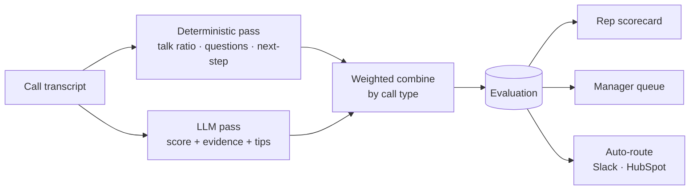

# Phase 2 — Build Something That Runs

## Rep Coach — post-call evaluation & coaching

**Janos Kristof** · GTM AI Enablement · *prepared under NDA, call data anonymized*

The bet from Phase 1 — *install measurement where there is none* — as a **running tool**.

---

## What I built

> **Rep Coach scores every call against a Sensi-tuned rubric, hands the rep two specific fixes for
> the next call, and hands the manager a triaged coaching queue — without an hour of manual review.**

It creates the baseline **from call one** — and offloads the review from the manager.

---

## How it scores — half math, half judgment, always explainable

Deterministic signals are computed **in code**; the rest is Claude via tool-use — and **every LLM
score cites a verbatim quote.** Nothing is an unexplained number.

| Dimension | Signal | How |
|-----------|--------|-----|
| Talk / listen balance | **deterministic** | rep vs. prospect airtime, monologue penalty |
| Discovery quality | **hybrid** | open-question density blended with LLM judgment |
| Proof fidelity | **LLM** | claims vs. Sensi's *published* proof wall → catches invented numbers |
| Next step | **hybrid** | firm, dated commitment booked? |

Weights are per call type and live in `rubric.yaml` — **retune without touching code.**

---

## The surface a rep/manager actually uses

A **user picker** drives it; the core loop is **call list → detail** — no sidebar, no toy.

- **Rep** → *My Calls · Trends · Activity* (their own data)
- **Manager** → *Calls · Team · Trends · Measurement · Activity* (every rep)
- Open a call → **scorecard + Coach's next steps + the transcript + per-call activity**
- An **unscored** call has a **⚡ Process** button — runs the real engine live and **auto-routes**
  the coaching loop (the manual stand-in for production's post-call trigger)

---

## How I built it — an agentic SDLC (the meta-proof)

> **requirements → design → implement → verify in the *running* app → adversarial review → iterate**

*One person + AI agents doing what used to take an ops team.* Built in vertical slices; each slice
run to its acceptance criterion. The loop **caught real defects**, e.g.:

- A demo-blocking **native segfault** (bleeding-edge Streamlit/pandas/pyarrow) → pinned versions
- **Structured-output** quirks → retries + coercion + score clamping
- A human click-through caught **UX gaps a text reviewer can't feel** → became AC9/AC10
- Templating surfaced a **hardcoded coupling** → generalized the engine to be fully rubric-driven

A committed Playwright suite (`verify_ui.py`) drives every surface; a golden-bad call must score
low on exactly its failing dimensions and fire the pressure flag.

---

## How it's measured — "if you can't measure it, it didn't work"

| Leading · internal (weeks) | Lagging · external (quarter) |
|----------------------------|------------------------------|
| **Adoption** — rec-adoption · tasks completed / followed up · coverage | Call-quality trend |
| **Usage** — weekly-active reps · content engagement · return rate | Ramp-time to productivity |
| **Behavior change** — fixes recur on later calls · flagged-dim movement | Conversion / win-rate |

**Honest baseline:** none of this is measured today. Internal metrics are computed from real
evaluations now; lagging ones wire to HubSpot outcomes in production. **The tool creates the baseline.**

---

## Templating — proven now, not promised (AC8)

The engine is generic; **only the rubric + the signal source change per team.**

> A second instance — **Customer-Support QA** (`rubric_csqa.yaml`) — scored a support call at
> **93/100** through the **unchanged** engine. *A new team was a new YAML, not new code.*

The Phase-1 "one build → many pains" and this "one engine → many teams" are the same idea on two
axes — **the compounding argument, made concrete.**

---

## Path to production & what's next

**To production** *(deep dive = the production-readiness session):*
- **Trigger** — a Jiminny call-complete webhook replaces the manual Process button
- **Surface** — **HubSpot** as the single pane: scorecard on the call record, follow-ups as tasks,
  native dashboards; Slack nudges deep-link back (kills the multi-tool jump, pain #1)
- **Data safety** — zero-retention + BAA LLM, in-region; prototype sends only synthetic text
- **Human-in-loop** — escalations, rubric changes, high-stakes coaching stay human

**Next:** real trigger + HubSpot write-back · rubric v2 from won/lost outcomes · content loop ·
a second team live on real calls.
