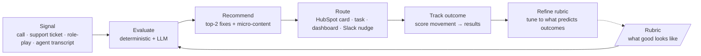
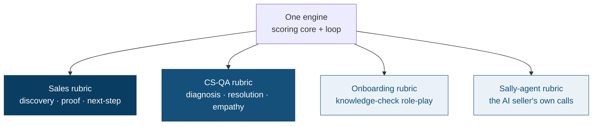

# Phase 3 — Make It a Playbook

**Scalability brief** · Janos Kristof · *the pattern that compounds across every team*

> Rep Coach isn't the deliverable — it's the **first instance of a repeatable architecture.** The
> same engine that scores a sales call scores a support call, an onboarding role-play, or an
> AI-agent transcript **by swapping a rubric (and, for onboarding, the signal source) — not writing
> code.** This brief names that
> architecture, proves it already works with a second team, and states what scales automatically vs.
> what stays human.

---

## 1. The pattern, named — the enablement loop

Every team's version of "are we getting better at this?" is the same loop. Only the **signal source**
and the **rubric** change per team; the engine is generic.

`Signal → Rubric → Evaluate → Recommend → Route → Track → Refine.` The refine arrow is what makes it
a *loop* and not a report: the rubric improves as outcomes accumulate.

---

## 2. Why it compounds — the same idea on two axes

The Phase-1 diagnosis already showed the loop's artifacts — the **rubric** and the **evaluation
data** — each serve *several pains at once* (**one build → many pains**). Phase 3 is the same overlap
turned outward: **one engine → many teams.** The compounding is the overlap.

| Axis | What's reused | Example |
|------|---------------|---------|
| **One build → many pains** (Phase 1) | Same rubric + eval data serve QA, manager load, rep support directly; unlock knowledge, ramp, stack | 3 pains solved, 3 unlocked from one build |
| **One engine → many teams** (Phase 3) | Same scoring engine + loop serve sales, CS, onboarding, agent-tuning by rubric swap | 1 engine, N rubrics |

Both axes are powered by the *same two artifacts built once.* That's the definition of a leverage
point — the smallest build that moves the most, on both axes.

---

## 3. Proven now — the < 1-day templating test (AC8)

This is not a promise; a **second team already runs on the unchanged engine.** I built a
Customer-Support QA rubric (`rubric_csqa.yaml`), pointed the engine at a support-call transcript, and
it scored **93/100** with support-specific dimensions — **zero engine code changed**
(`verify_ac8.py`). A new team was a new YAML.

| What changes per team (config) | What's reused (the engine) |
|--------------------------------|----------------------------|
| Dimensions + weights (per call/interaction type) | Deterministic metrics (airtime, question density, next-step) |
| The prescribed **motion** and **proof wall** | The Claude tool-use structured-output pass |
| The **evaluator role** and the **flag set** | The weighted combine + capped-penalty scoring |
| The **signal source** (what gets fed in) | Routing (the `Notifier`/`CRM` adapter seam) + the surfaces |

**Honest boundary:** reusing the existing deterministic signal *keys* (airtime, questions,
next-step) is pure config — those transfer across teams. A genuinely *new* deterministic signal
(say, support hold-time) is a **one-time** addition to the engine, after which it too is config. The
LLM-judged dimensions, weights, motion, proof, role, and flags are already fully rubric-driven — so
the *common* case of standing up a team is a YAML, not an engineer.

---

## 4. The templating map — which teams, what changes

| Team | Signal source | What changes | Status |
|------|---------------|--------------|--------|
| **Sales** (human reps) | Jiminny call transcript | — (the original) | **Built** (Phase 2) |
| **Customer-Support QA** | Support-call transcript | Rubric swap only | **Proven** (AC8 · 93/100) |
| **Onboarding / ramp** | Knowledge-check **role-play** transcript | **Swap the signal** + a knowledge rubric — the rubric *is* the onboarding standard | Next |
| **Sally (the AI seller agent)** | Sally's own call transcripts | Rubric swap — same loop tuning the AI agent instead of a human | Future instance of the same pattern |

The onboarding case is the important tell: it swaps the *signal* (a role-play, not a live call) while
keeping the engine — proving the pattern generalizes beyond "score a sales call." And Sally-tuning
shows the loop even scales to the product Sensi *sells*.

---

## 5. What scales automatically vs. what stays human

Scaling to N teams only works if adding a team doesn't add N managers' worth of judgment. The
boundary (from the production-readiness session) is the scaling principle:

- **Automated (scales for free per team):** ingest the signal, score every interaction, attach the
  scorecard, route nudges + draft coaching tasks, compute trends and coverage.
- **Human (scales with people, deliberately):** **rubric authorship + changes** (what "good" means
  for a team is a human call, versioned), **escalations** (a very low score / fired flag surfaces;
  a person decides), and **high-stakes coaching**. The tool triages and drafts; a human owns the
  conversation and the standard.

This is why the pattern compounds instead of collapsing: the mechanical work is `O(1)` per team; the
human work is only the *rubric* and the *hard conversations*.

---

## 6. The feedback loop that improves the system

The `Refine` arrow is the compounding engine. Once each team's scores link to outcomes (won/lost,
CSAT, ramp-time), the rubric is tuned to **what actually predicts results**, and a lightweight
manager-correction step (managers occasionally overriding a score) produces the labels that improve
the rubric over time. Every team's loop gets *smarter* with use — and improvements to the engine
(robustness, new deterministic signals) lift **every** team at once. The platform appreciates.

---

## 7. How you'd know the *system* is working

The Phase-2 leading/lagging metrics apply per instance; at the **system** level, the questions are
about the *pattern*:

- **Time-to-template** — days to stand up a new team (target: < 1 day; AC8 is the existence proof).
- **Teams live** and **coverage per team** (share of interactions actually scored).
- **Cross-team behavior movement** — flagged-dimension improvement, per team, after coaching.
- **Rubric health** — version cadence + how often outcomes force a re-tune (a rubric that never
  changes is probably not being trusted).
- **Lagging, per instance** — sales conversion/ramp, CS resolution/CSAT, onboarding time-to-productive.

Same measurement discipline as Phase 2 — *"if you can't measure it, it didn't work"* — applied to the
architecture, not just one tool.

---

## 8. This is a pattern, not a roadmap

The deliverable here is **not** a feature timeline — it's a **repeatable architecture**: one engine,
one loop, a rubric per team, an explicit human boundary, and a refine step that makes the whole
system improve with use. The near-term build order (real trigger, HubSpot write-back, second team on
real calls) lives in `phase2_build/tool_note.md`; the *pattern* is what makes each of those a
one-time instantiation rather than a new project. **One person + this pattern = an enablement
function that compounds across every team Sensi has — and the ones it doesn't have yet.**
