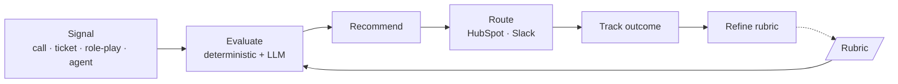
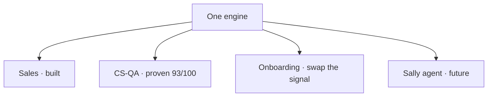

# Phase 3 — Make It a Playbook

## The pattern that compounds across every team

**Janos Kristof** · GTM AI Enablement · *prepared under NDA, call data anonymized*

Rep Coach isn't the deliverable — it's the **first instance of a repeatable architecture.**

---

## The pattern, named — the enablement loop

Only the **signal source** and the **rubric** change per team. The engine is generic.

`Signal → Rubric → Evaluate → Recommend → Route → Track → Refine.` The refine arrow makes it a loop,
not a report — the rubric improves as outcomes accumulate.

---

## Why it compounds — the same idea on two axes

- **One build → many pains** (Phase 1) — the same rubric + eval data serve QA, manager load, rep
  support directly; unlock knowledge, ramp, stack.
- **One engine → many teams** (Phase 3) — the same engine + loop serve sales, CS, onboarding,
  agent-tuning by **rubric swap**.

> Both axes are powered by the **same two artifacts built once.** The overlap *is* the compounding.

---

## Proven now — the < 1-day templating test (AC8)

Not a promise — a **second team already runs on the unchanged engine.** A CS-QA rubric scored a
support call **93/100**, zero engine code changed (`verify_ac8.py`).

| Changes per team (config) | Reused (the engine) |
|---------------------------|---------------------|
| Dimensions + weights | Deterministic metrics |
| Motion + proof wall | Claude structured-output pass |
| Evaluator role + flags | Weighted combine + routing seam |
| The signal source | — |

*Honest boundary:* a genuinely new deterministic signal is a one-time engine add; the common case is
a YAML, not an engineer.

---

## The templating map — one engine, many rubrics

- **Sales** — built (Phase 2) · **CS-QA** — proven (AC8)
- **Onboarding** — swap the *signal* (role-play, not a live call); the rubric *is* the standard
- **Sally** — the loop even tunes the AI agent Sensi *sells*

---

## What scales automatically vs. stays human

Adding a team must not add a manager's worth of judgment.

- **Automated (O(1) per team):** ingest signal, score every interaction, attach scorecard, route
  nudges + draft tasks, compute trends + coverage.
- **Human (deliberately):** rubric authorship/changes, escalations, high-stakes coaching.

> The mechanical work is O(1) per team; the human work is only the *rubric* and the *hard
> conversations*. That's why it compounds instead of collapsing.

---

## A pattern, not a roadmap

> **One engine · one loop · a rubric per team · an explicit human boundary · a refine step that makes
> the whole system improve with use.**

The near-term build order lives in the tool note; the *pattern* is what makes each new team a
one-time instantiation, not a new project. Improvements to the engine lift **every** team at once —
the platform appreciates.

**One person + this pattern = an enablement function that compounds across every team Sensi has — and
the ones it doesn't have yet.**
