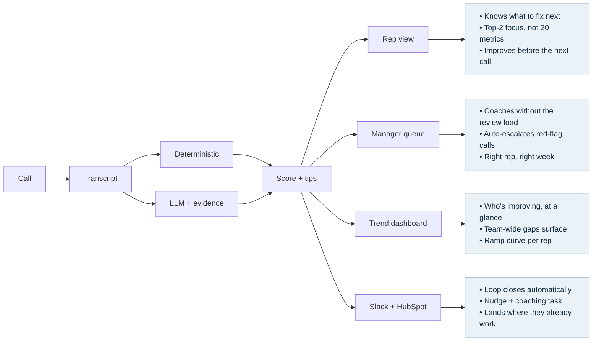
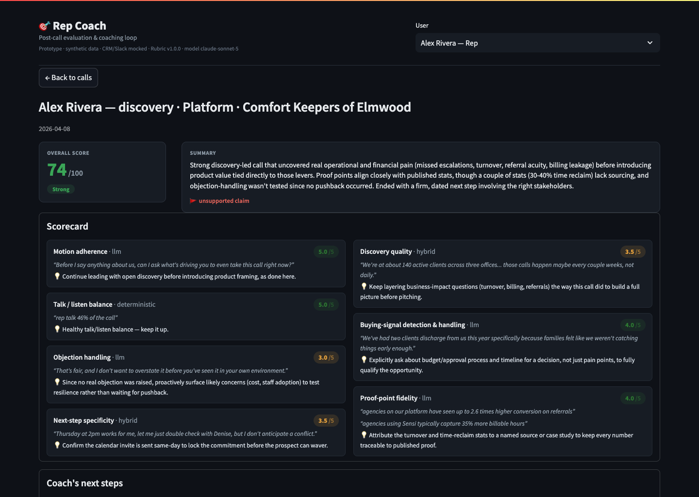
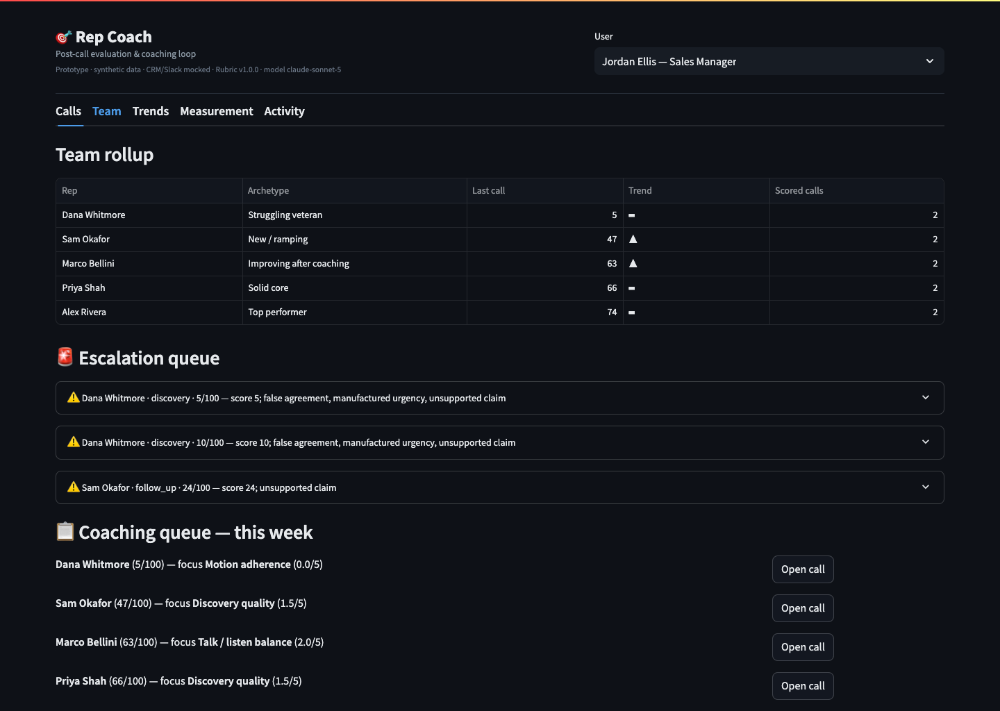
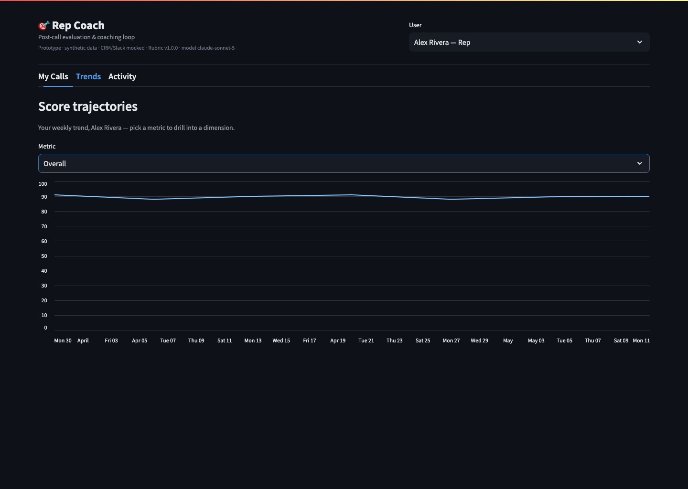
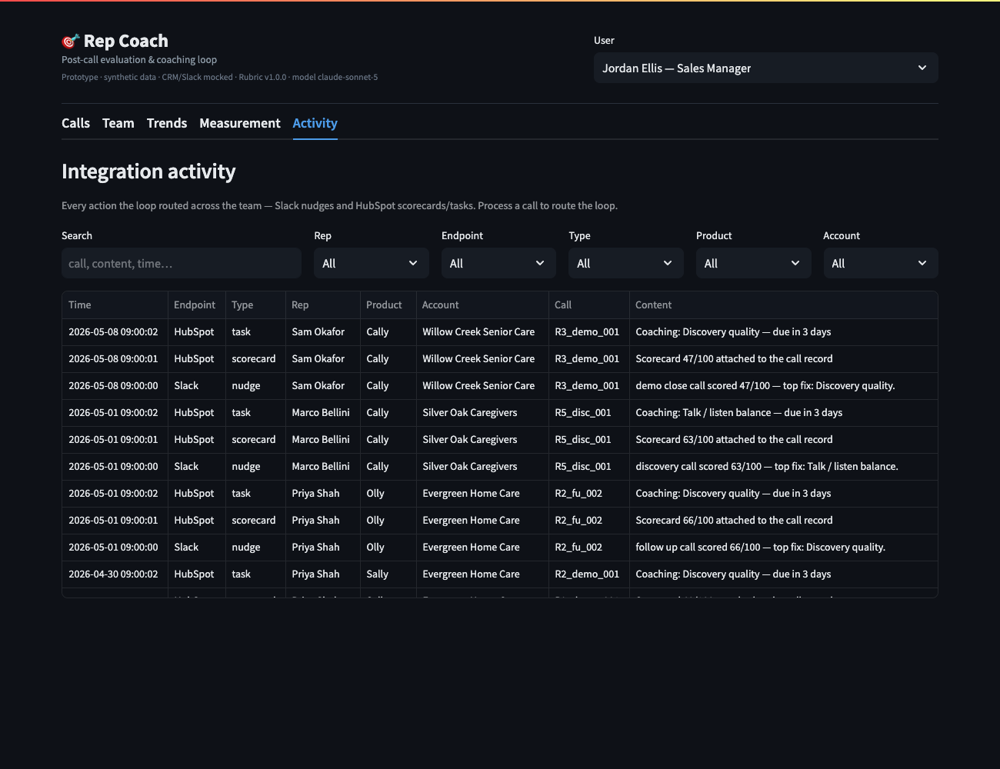
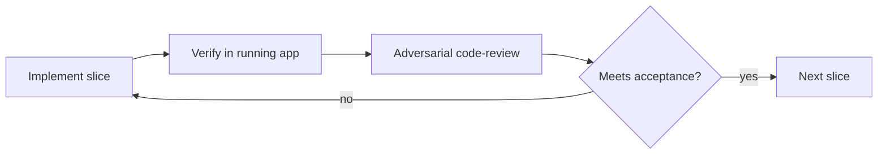
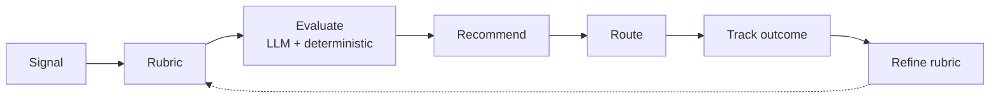
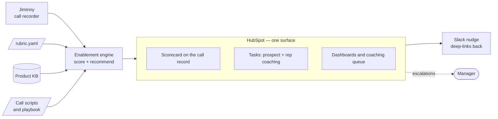

# Seller Enablement Intelligence

## From a measurement vacuum to a system that compounds

**Janos Kristof** · GTM AI Enablement Lead — take-home · janos.kristof@gmail.com

*Prepared under NDA · call data anonymized*

Better sellers → more agencies say yes → **more seniors get care.**

---

## How I work — and today's path

**One operating line:** interrogate the *real* problem → build one thing that **runs** → make it a **pattern.**

| Act | What you'll see | Time |
|-----|-----------------|------|
| 1 · Diagnose | The real problem, found in the data | ~12 min |
| 2 · Build | Rep Coach — **live demo** | ~15 min |
| 3 · Scale | The loop that compounds across teams | ~12 min |
| + Production | What it takes to run for real | ~5 min |

All phase deliverables submitted in advance. **The tool is live — I'll demo it.**

---

## The stated problem is six pains. The real problem is one.

The brief lists six pains. Read as **symptoms**, they share one root cause:

> There is no closed loop that turns each sales call into **tracked, improving rep behavior.**

Sensi generates rich behavioral signal on every call — and throws it away. **That measurement vacuum is the leverage point.**

:::detail
The six pains — fragmented stack · manual/ad-hoc QA · overloaded managers · no AI support for reps · inconsistent persona & product knowledge · slow onboarding ramp — are all downstream of the same missing loop.
:::

---

## How I got there — I read the brief as a rubric

I mined **every** source (brief · GTM deck · Guide Book · website · 17 customer videos · the real Jiminny call), then mapped **who I'd talk to, in order, and what I'd ask:**

| # | Who I'd talk to | What I'd ask |
|---|-----------------|--------------|
| 1 | Ops leadership (the two Daniels) | What are the priorities — what would have the largest business impact? · What does "getting better" look like? · What's been tried and failed? |
| 2 | VP Sales | Which *one* behavior, fixed, moves the number most? · Top vs. bottom rep — the real difference? · How many reps, teams, and calls a week — and where's the growth? |
| 3 | Reps — top / ramping / struggling | Walk me through a recent won *and* lost call — where did each turn? · How do you prep, and what do you do after? |
| 4 | Sales managers | What are your priorities? · What are your biggest challenges? |
| 5 | RevOps / HubSpot owner | Where does stage-conversion leak? · What's in Jiminny/HubSpot we're not using? · What's our weekly call volume, and what % is recorded? |
| 6 | Onboarding lead | What's measured today vs. left to shadowing? · Where do new reps stall? |

---

## Beyond the brief — what I'd find, and how I'd read it

**Data I'd go find that isn't in the brief — and where it lives:**

| Data I'd pull | Where it lives |
|---------------|----------------|
| Win/loss by rep & stage | HubSpot (CRM) |
| Ramp cohorts / time-to-productivity | Onboarding + HR records |
| Call coverage + existing call analytics | Jiminny |
| Org sizing — # teams · reps · calls/week | HubSpot · Jiminny · sales ops |
| Stage-conversion leaks | HubSpot pipeline |
| Deal outcomes / CSAT | HubSpot / support |

**Turning raw input → a clear picture:**

- **Score a sample of 15–20 recent calls** with an ad-hoc LLM evaluation, then **review the findings with reps and sales managers** — see how *common* the gaps are and validate the rubric with the people who live it (never generalize from one)
- **Cross-reference behavior → outcomes** — which call behaviors track with won deals and faster ramp
- **Funnel six symptoms → one root cause**, cross-checking every claim against Sensi's **published proof**

---

## The tell — this one call broke Sensi's *own* playbook

A *sample, not a verdict* — but revealing. The rep **inverted Sensi's prescribed motion** (opened with a screen-share, skipped discovery) and **invented numbers** instead of Sensi's published proof:

| Rep said (this call) | Sensi actually publishes |
|----------------------|--------------------------|
| "$623K, unbelievably conservative" | ~$500K avg savings — the rep *overshoots* |
| "3.3-mo LoS, 1,000-agency survey" | "2× length of stay"; no such survey exists |
| "Sally = 3–4× a salesperson" | "your entire inside sales force in one agent" |

**Nothing measures whether *any* call uses Sensi's own motion and proof. That's the vacuum.**

---

## The bet — one build moves the most pains

Biggest leverage point: an **automated post-call evaluation + coaching loop.** The same two artifacts — **the rubric + the evaluation data** — address all six pains:

| # | Pain (from the brief) | Potential solution / recommendation | Impact |
|---|-----------------------|-------------------------------------|--------|
| 2 | QA manual / not happening | Every call auto-evaluated vs. a consistent rubric | ● Direct |
| 3 | Managers overloaded | Pre-scored calls → triaged coaching queue + auto-escalation | ● Direct |
| 4 | Reps lack AI support | Personal scorecard → top-2 fixes + micro-content | ● Direct |
| 1 | Fragmented stack | The loop is the spine → consolidates onto HubSpot | ◐ Unlocks |
| 5 | Inconsistent knowledge | Product-claim scoring exposes gaps → routes content | ◐ Unlocks |
| 6 | Long onboarding ramp | Objective ramp curve; the rubric *is* the standard | ◐ Unlocks |

**`●` directly solved (2/3/4) · `◐` unlocked (1/5/6)** — the smallest build that moves the most. It *creates* the baseline from call one.

---

## What I built: Rep Coach
**Scores every call against a Sensi-tuned rubric, hands the rep two fixes, and hands the manager a coaching queue — without an hour of review.**

*Prototype: Streamlit + Python + Claude · runs offline on synthetic data + 1 anonymized real call.*

---

## ▶ Live demo — Rep Coach
**I'll drive the running tool** — pick a user, open a call, watch the loop close. Stills below back it up.

1. **Rep scorecard** — open a scored call: per-dimension chips, **evidence quotes**, Coach's next steps
2. **Process a call live** — an *unscored* call → **⚡ Process** → the real engine scores it in seconds and **auto-routes** to (mock) Slack + HubSpot — the loop closing, live
3. **Manager** — team rollup + escalation queue · Trends: the 5 rep archetypes' curves
4. **Activity feed** — every routed Slack nudge + HubSpot scorecard/task in one place: the closed loop, auditable

---

## How it scores — hybrid + explainable
Managers trust it because half the score is **math**, and the LLM half **always cites the quote.**

| Dimension | What it measures | Signal |
|-----------|------------------|--------|
| Talk / listen balance | Rep vs. prospect airtime | Deterministic |
| Discovery quality | Open vs. leading questions | LLM + counts |
| Buying-signal catch | Did the rep hear it? | LLM (evidence) |
| Next-step specificity | Firm, dated commitment? | LLM |
| Product-claim accuracy | Matches Sensi's proof? | LLM (evidence) |

*`rubric.yaml` — call-type-aware, weighted, versioned. **This file is the reusable seam for Phase 3.***

---

## How I built it — an agentic SDLC
I built this **the way this role operates:** one person + AI agents doing what used to take an ops team.

*Vertical slices · a golden-transcript test (a known-bad call must score low) · verify = behavior in the running app, not just unit tests.*

:::detail
**The loop caught real defects:** a demo-blocking native segfault (version-pinned) · structured-output quirks (retries + score clamping) · UX gaps a text-reviewer can't feel → became AC9/AC10 from a human click-through · a templating coupling generalized so the engine is now fully rubric-driven.
:::

---

## How we measure it — if you can't measure it, it didn't work
| Leading — internal (weeks) | Lagging — external (quarter) |
|----------------------------|------------------------------|
| **Adoption** — rec-adoption · coaching **tasks completed / followed up** · coverage % | Call-quality trend per rep |
| **Usage** — weekly-active reps · **training / coaching-content engagement** · return rate | Ramp-time to full productivity |
| **Behavior change** — **recommended fixes show up on later calls** · flagged-dimension movement | Conversion / win-rate |

**Honest note:** no baseline exists today — **the tool creates the baseline from call one.**

*Lagging metrics map to Sensi's real outcomes: the same conversion and ramp numbers the business already tracks.*

---

## Make vs. buy — build the thin layer, not the CI tool

*"Jiminny/Gong already do call coaching — why build?"* We **don't** rebuild conversation intelligence — we build the **Sensi-specific loop** on top, CI-tool-agnostic. How I'd decide each piece:

| Component | Buy candidates to weigh | The question that decides it |
|-----------|-------------------------|------------------------------|
| Call capture / transcription | **Jiminny** (in stack) · Gong · Avoma · Chorus | Commodity — does it capture + transcribe cleanly? |
| Knowledge base · content | Guru · Notion · Confluence + AI search | Mature category we'd configure, not build? |
| Training / enablement | Highspot · Seismic · Mindtickle | Off-the-shelf — and does our loop just feed it? |
| Dashboards / BI | HubSpot native · Metabase · Looker | Where do managers already live? |
| Orchestration | HubSpot Workflows · n8n · Temporal | Lightest that clears NDA / data-residency? |
| LLM (NDA-critical) | Anthropic · Bedrock · Azure OpenAI | Zero-retention + BAA + in-region? |

**The one thing I build: the scoring + coaching loop** — rubric tuned to persona + failure modes, feedback → outcome, templatable. No off-the-shelf tool delivers it as one closed system.

---

## The enablement loop — one engine, many teams

**The engine is generic — only the rubric + the signal source change per team.** A new team = a new rubric, not new code:

| Team | Swap the rubric for… | Signal | Status |
|------|----------------------|--------|--------|
| Sales | discovery / close quality | Jiminny call | Built |
| CS QA | support quality | support call | **Proven — 93/100** |
| Onboarding | knowledge-check | role-play | Next (swap the signal) |

**Proven, not promised:** CS-QA scored a support call **93/100 on the *unchanged* engine** (`verify_ac8.py`). *A new deterministic signal is a one-time engine add — the common case is a YAML.*

---

## Architecture & data flow — one surface in production

**No more tool-jumping (pain #1):** reps and managers live in **HubSpot** — the score is on the call, follow-ups are tasks, trends are dashboards. New artifacts — the **product KB** and **call scripts / playbook** — ground the scoring and feed the rep's next content.

---

## What it takes to run it for real
- **Trigger** — a Jiminny "call-complete" webhook fires the engine; no manual upload
- **Data safety & access** — zero-retention + BAA LLM · PII handling · in-region · **RBAC** (reps see own, managers their team; sensitive coaching scoped) · audit trail
- **Guardrails** — forced structured output · every LLM quote verified against the transcript · a deterministic score anchor · versioned rubric, humans own changes
- **Human-in-loop** — managers own escalations, rubric changes, high-stakes coaching
- **Orchestration** — the lightest thing that clears data-residency: HubSpot Workflows / Operations Hub first; n8n *challenged*, not assumed
- **Runs without me** — monitoring · one-command deploy · config-over-code — it keeps running long after I've moved on

:::detail
Cost model and the finalized production make-vs-buy (capture · scoring · routing · KB · BI) are in the dedicated production session; the LLM trust mechanics are detailed in the **Trust & guardrails** appendix.
:::

---

## The compounding proof — same idea on two axes

- **Phase 1:** one build → **many pains** — rubric + evaluations move all six
- **Phase 3:** one engine → **many teams** — a rubric swap serves Sales, CS, onboarding

> The overlap **is** the compounding. Build the loop once; every future enablement problem becomes a rubric, not a project.

**And the stakes are real:** one agency took conversion **33% → 85%** on camera. Better sellers → more agencies say yes → **more seniors get care.**

---

## Appendix · Rep Coach on HubSpot — the production surface

In production Rep Coach ships **no UI** — it writes into HubSpot's own objects, so reps and managers act where they already work. **Kills the multi-tool jump (pain #1).**

| Rep Coach output | HubSpot mechanism | Who acts on it |
|------------------|-------------------|----------------|
| Evaluation (scores + evidence) | **Custom object** `Call Evaluation` — linked to Call · Contact · Deal · rep | Feeds everything below |
| Scorecard on the call | **CRM card** (UI Extension) on the record · or scores as call **properties** | Rep (own) · manager (team) |
| Coach's next steps | **Tasks** to the rep — due-dated, linked to micro-content | Rep's task queue |
| Prospect next steps | **Tasks** on the deal · optional **sequence** | Rep's task queue |
| Escalations (low score / red-flag) | **Workflow** → manager task / alert | Manager |
| Trends + coaching queue | Native **Reports & Dashboards** + a filtered **list** on the eval object | Manager dashboard |
| Nudge ("your call was scored") | **Slack** message that **deep-links back** into HubSpot | Rep (sent into HubSpot) |

**Tier caveat (discovery item):** custom objects → Enterprise · UI extensions → dev projects · programmable automation → Operations Hub Pro+. **Degrades gracefully** — call properties + Notes + standard Tasks + workflows on lower tiers, and the loop still closes.

---

## Appendix · Trust & guardrails — keeping the LLM reliable in production

A score is only useful if a manager can trust it. Reliability is **engineered in**, not hoped for — most of it already built:

| Risk | Guardrail | Status |
|------|-----------|--------|
| LLM invents a score | **Deterministic anchor** — talk/listen & question counts scored in code; hybrid dims average code + LLM | Built |
| Free-text drift / parse errors | **Forced structured output** — tool-use schema, not text parsing · retries · score clamping | Built |
| Hallucinated evidence | **Quote verification** — every LLM evidence quote checked near-verbatim against the transcript | Built |
| Prompt injection (transcripts are untrusted input) | Transcript treated as **data, not instructions**; scored fields constrained by the tool schema | Design |
| Criteria drift over time | **Versioned rubric** — humans own rubric changes; every eval records the rubric version | Built |

**One-line version:** half the score is math the LLM can't move, and the LLM half must cite the quote or it's caught.
