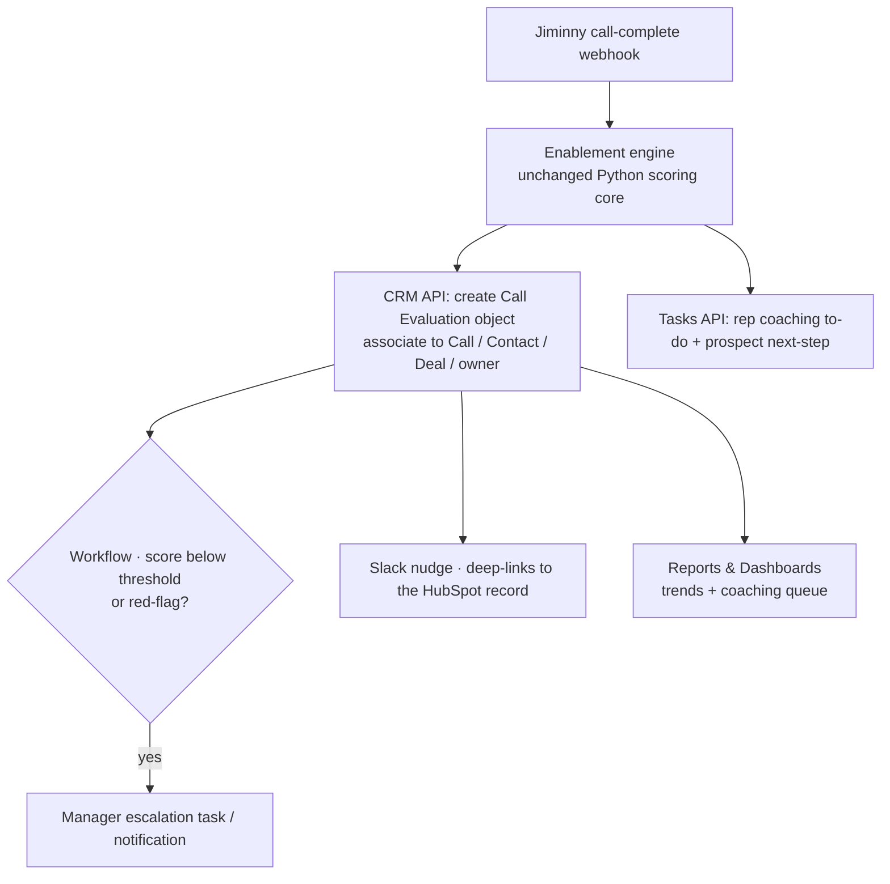

# Rep Coach on HubSpot — the production surface

**How Rep Coach's outputs become visible and actionable inside HubSpot** — the concrete mechanics
behind the "HubSpot is the one surface" architecture (production-readiness §3). Assumes the call
already lives in HubSpot: Jiminny's native integration logs each call as a **call engagement** on
the contact/deal, with the recording and transcript attached.

## The core idea

In production, Rep Coach **does not ship a UI** — it writes its outputs into HubSpot's existing
objects so reps and managers act on them *where they already work*. The engine's job ends at
"produce an evaluation record"; HubSpot's APIs turn that record into records, tasks, cards, and
dashboards. This is what kills the multi-tool jump (**pain #1**): one surface, not a new one.

## Output → HubSpot mechanism

| Rep Coach output | HubSpot mechanism | How it's written | Who sees it |
|---|---|---|---|
| **The evaluation** (overall + per-dimension scores, evidence quotes) | A **custom object** `Call Evaluation`, associated to the Call, Contact, Deal, and rep (owner) | CRM API `POST /crm/v3/objects/{type}` + Associations API v4 | Reportable; feeds dashboards |
| **Scorecard on the call** | A **CRM card (UI Extension)** on the Call/Contact/Deal record — *or* scores mirrored as **custom properties** on the Call | UI Extensions SDK (React card reads the eval object) / Properties API | Rep on own, manager on team |
| **Human-readable summary** | A **Note** engagement on the call/deal | `POST /crm/v3/objects/notes` + association | Anyone on the record |
| **Coach's next steps** (rep self-improvement) | **Tasks** assigned to the rep, due-dated, linked to micro-content | `POST /crm/v3/objects/tasks` (owner = rep, `hs_timestamp` = due) | Rep's task queue |
| **Prospect next steps** ("book a firm next meeting") | **Tasks** on the deal, optional **sequence** enrollment | Tasks API / Sequences | Rep's task queue |
| **Escalations** (red-flag / low score) | **Workflow** → task/notification to the manager | Operations Hub workflow on a score-property threshold | Manager |
| **Trends** (score over time, per rep/dimension) | Native **Reports & Dashboards** over `Call Evaluation` | Custom report builder | Manager dashboard |
| **Coaching queue** | A **saved view / active list** of evaluations filtered to low scores or flags | List builder on the custom object | Manager |
| **Nudge** ("your call was scored") | **Slack** message that **deep-links back** to the HubSpot record | Slack API + record URL | Rep — sends them *into* HubSpot |

## Why a custom object, not just properties on the call

Writing scores as **custom properties on the Call** is the quick path and is enough for basic
reporting — but a dedicated **`Call Evaluation` custom object** is the better production design:

- **Re-scoring is first-class.** A rubric v2 or a re-run creates a new evaluation record with
  history, instead of overwriting the last one.
- **Structured per-dimension data.** Each dimension + its evidence lives in a queryable field, so
  the coaching queue is just a filter: *"evaluations where `discovery_quality` < 2."*
- **Multi-way roll-up.** Associations let one eval roll up to the **rep** (for trends), the **deal**
  (for outcome linkage), and the **call** (for context) at the same time.

## Trends & dashboards, concretely

Because each dimension is a numeric property on the eval object, HubSpot's report builder produces
these **natively** — no separate BI tool (this is where the make-vs-buy "BI → HubSpot-native"
verdict cashes out):

- **Avg overall score per rep, per week** — the archetype curves from the demo.
- **Per-dimension movement** — is discovery improving after coaching?
- **Coverage %** — evaluations created ÷ calls logged (calculated property or report ratio).
- **Coaching-task completion / follow-up rate** — from Task status; this is the *adoption* metric on
  the measurement slide, wired to real HubSpot data.
- **Behavior change** — join eval scores to deal outcomes to see if coached behaviors track with won
  deals.

The **manager dashboard** = those charts + the coaching-queue list.

## End-to-end flow

## Prototype → production (the adapter seam already anticipates this)

What the prototype **mocks today** maps 1:1 to the production HubSpot calls — the swap is an adapter
change, not a rewrite:

| Prototype (`adapters.py`) | Production implementation |
|---|---|
| `MockCRM.attach_scorecard(...)` | `HubSpotCRM` → create `Call Evaluation` object + associations (CRM API) |
| `MockCRM.create_task(...)` | `HubSpotCRM` → `POST /crm/v3/objects/tasks` (owner, due date, association) |
| `MockNotifier.send_nudge(...)` | `SlackNotifier` → Slack message with the HubSpot deep-link |

## Permissions & visibility

HubSpot **Teams** + property/object-level permissions: reps see their own evaluations and tasks;
managers see their team's; sensitive coaching notes can be scoped tighter. This is the RBAC answer
for the HIPAA-adjacent posture.

## Tier caveat (the discovery item) + graceful degradation

Several capabilities require **Enterprise / Operations Hub / a developer account** — confirm what
Sensi is licensed for before committing:

- **Custom objects** → Sales/Service Hub **Enterprise**
- **UI Extensions / CRM cards** → developer projects, paid seats
- **Programmable automation** (custom-code workflow actions, webhooks) → **Operations Hub Pro+**
- **Custom-object reporting** → Pro/Enterprise

**Fallback on lower tiers:** mirror scores as **custom properties on the Call** + a **Note** +
standard **Tasks** + **standard workflows**. You lose multi-eval history and the richest reporting,
but the loop still closes. That the design **degrades gracefully** is itself worth stating.

## Discovery questions to confirm with Sensi

- Which HubSpot tier(s) are licensed today — Sales/Service Hub Enterprise? Operations Hub?
- Is the **Jiminny ↔ HubSpot** integration live, and does it sync the transcript (not just the recording)?
- Do calls already associate cleanly to **deals**, or only to contacts? (Outcome linkage needs deals.)
- Existing **Teams / permission** structure for rep-vs-manager visibility?
- Any **BAA / data-residency** constraints that affect where the eval text is stored?
