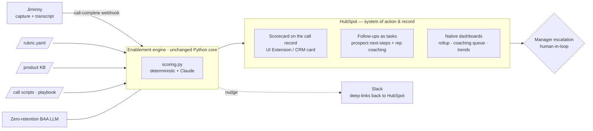

# Rep Coach — Production Readiness

**Supporting deep-dive** · Janos Kristof · *what it takes to run the prototype for real — safely,
and without me*

> The prototype proves the loop works. This is the honest answer to the three questions a VP of Ops
> asks next: **how does it trigger itself, how does confidential call data stay safe, and how does
> it keep running long after I've moved on?** Scope and design are in `phase2_build/`; the
> component-level buy-vs-build framework is in `phase1_diagnose/make_vs_buy.md`.

---

## 1. From prototype to production — what's mocked, what's real

Everything load-bearing in the scoring loop is already real; what's mocked is the **plumbing around
it**, and each mock has a clean production swap because it sits behind an interface.

| Concern | Prototype (today) | Production |
|---------|-------------------|-----------|
| **Trigger** | Manual **Process** button | Jiminny **call-complete webhook** (§4) |
| **Scoring core** | Real — `scoring.py` (deterministic + Claude) | **Unchanged** — the differentiator ships as-is |
| **Routing** | `MockNotifier` / `MockCRM` → local JSON log | `SlackNotifier` / `HubSpotCRM` behind the same `Notifier`/`CRM` seam (§3) |
| **Surface** | Streamlit app | **HubSpot** — scorecard on the call record + tasks + dashboards (§3) |
| **LLM endpoint** | Anthropic API, synthetic text only | Zero-retention **BAA** endpoint, real (PII-bearing) transcripts (§5) |
| **Store** | `data/*.json` | CRM record + a small evaluations store; versioned rubric |
| **Access** | Single local user | **Auth / RBAC** — rep sees own, manager sees team (§5) |

The design intent from day one (`design.md` §6) was that **capture is bought, the loop is built, and
routing is an adapter swap** — so "productionizing" is wiring, not a rewrite.

---

## 2. Orchestration decision — decided, with reasoning

**The question:** once Jiminny fires "call complete," what runs the sequence *get transcript → score
→ branch → route → persist*? This was the one row left **OPEN** in `make_vs_buy.md` (now
closed to the decision below). I evaluated it against the make-vs-buy criteria that matter for a **one-person ops function at a HIPAA-adjacent,
Series-C company**: NDA/data-residency fit, testability + prompt/version control, observability,
maintenance-by-one-person, and lock-in.

| Option | Data-residency / NDA | Testable LLM logic | One-person ops | Verdict |
|--------|----------------------|--------------------|----------------|---------|
| **No-new-tool** — HubSpot Workflows / Operations Hub + a small service | Good (HubSpot already holds the data) | Weak in-platform; core stays in the service | **Best** — no new surface | **Test first** |
| **n8n (self-hosted)** | **Excellent** — self-hostable, in-region | Weak in-node; fine if it *calls* the core | Another runtime to run/monitor | **Fallback when complexity grows** |
| Zapier / Make | Weaker — SaaS data path under NDA/HIPAA | Weak | Low, but cost + residency concerns at scale | Rejected |
| Temporal / Windmill / Prefect | Good (self-host) | **Strong** (code-first) | Heaviest to operate | Overkill now |
| Custom Python service | Full control | **Strong** | Most to maintain | The core *is* this already |

**Decision.** **Keep the scoring core in code** — it must stay testable (the golden-transcript
check), prompt-versioned, and robust to structured-output quirks (all hardened in Phase 2). Then
**use the lightest orchestration that clears NDA/data-residency**: since **HubSpot is confirmed as
the CRM**, test **HubSpot Workflows / Operations Hub + a thin scoring service** *first* — it adds no
new vendor and keeps the data in one place.

**When a platform earns its keep.** An orchestration platform (self-hosted **n8n** is the strongest
NDA-friendly candidate) is justified **when complexity grows** — many triggers/signal sources, many
teams × rubrics running in parallel, branching human-in-loop approvals, and retries/monitoring at
scale. That's a *reach-for-it-when-justified* option, not a now-decision. Critically, adopting it
later is a **glue change, not a rewrite**: the `Notifier`/`CRM` adapter seam means the Python core
is reused unchanged and n8n's Slack/HTTP nodes simply implement the same interface. *We are not
locked out of it, and we are not locked into it.*

> **Anti-pattern rejected:** re-implementing scoring inside workflow Function nodes (deterministic
> math in JS + a raw LLM call). It throws away the tests and the structured-output hardening — the
> exact things that make the scores trustworthy. Buy the commodity, build the differentiator, keep
> the differentiator in code.

---

## 3. Production architecture — HubSpot as the single surface

The strongest fix for the multi-tool jump (**pain #1**) is to stop adding surfaces and make
**HubSpot the one place the work lives.** The scoring engine is unchanged; only the adapters and the
trigger become real.

> **The concrete HubSpot mechanics** — how each Rep Coach output maps to a HubSpot object (custom
> object · CRM card · Tasks · workflows · native dashboards), the prototype→production adapter
> mapping, the tier caveats, and the discovery questions — are worked in the companion deep-dive
> [`hubspot_surface.md`](hubspot_surface.md).

- **Scorecard on the call record** — the Jiminny call is an engagement on the contact/deal; the
  evaluation is written back via a **HubSpot UI Extension / CRM card** (or a linked custom object).
  Visibility follows RBAC: rep sees own, manager sees team.
- **Follow-ups as HubSpot tasks — two kinds:** prospect next-steps (dated tasks on the deal) *and*
  rep self-improvement to-dos (coaching, linked to micro-content). Routed by HubSpot Workflows.
- **Dashboards in HubSpot** — team rollup, coaching queue, per-rep/-dimension trends as native
  reports (the make-vs-buy "BI → buy later" verdict cashes out here; Streamlit was the prototype
  surface only).
- **Slack = nudge layer** — "your call was scored," "3 reps need coaching" — deep-linking back into
  HubSpot, not a second place to do the work.
- **Grounding artifacts feed the loop** — the **product KB** grounds proof-fidelity scoring and
  supplies recommended micro-content; **call scripts/playbook** ground motion-adherence scoring.

The prototype's `Notifier`/`CRM` protocols (`design.md` §6) are exactly the seam: `SlackNotifier`
and `HubSpotCRM` replace the mocks; **the core never changes.**

---

## 4. The trigger — no manual upload

Replace the manual Process button with a **Jiminny call-complete webhook**: Jiminny fires when a
call is transcribed → the orchestration layer fetches the transcript via Jiminny's API → the scoring
service runs → results write back to HubSpot and route the coaching loop. The rep and manager see the
scorecard **on the record** minutes after the call ends, with zero manual steps. (Discovery item:
confirm Jiminny's webhook + transcript-API availability on Sensi's plan — §10.)

---

## 5. Data safety & security — the NDA + HIPAA posture

Sensi handles senior-care data; call transcripts are confidential and HIPAA-adjacent. This is the
non-negotiable layer.

- **LLM endpoint** — a **zero-retention** contract with a **BAA** in place: Anthropic (zero-retention
  + BAA), **AWS Bedrock**, or **Azure OpenAI** (both offer BAA + in-VPC / in-region). Never build a
  model; the only thing that matters is the terms. *The prototype sends only synthetic text — no real
  PII has left the machine.*
- **PII handling** — transcripts stay in-region; optional PII redaction before the LLM call for
  fields not needed for scoring; encryption in transit + at rest.
- **Auth / RBAC** — rep sees own scorecards, manager sees team, high-stakes coaching scoped
  appropriately; inherited from HubSpot's permission model where the surface is HubSpot.
- **Audit** — every evaluation carries `rubric_version` + `model` (already in the record), so any
  score is reproducible and attributable — the basis of an audit trail.

---

## 6. Human-in-loop — the automated/human boundary

The loop **automates the mechanical** (scoring, routing, surfacing) and **keeps judgment human**:

- **Automated:** score every call, attach the scorecard, route nudges + draft coaching tasks,
  compute trends.
- **Human:** manager **escalations** (a very low score or a fired flag surfaces a call, a person
  decides), **rubric changes** (what "good" means is a human call, versioned), and **high-stakes
  coaching** conversations. The tool triages and drafts; it never delivers the hard conversation.

This is the same boundary Phase 3 carries across teams.

---

## 7. Production make-vs-buy — finalized

`make_vs_buy.md`'s leans hold; this session **closes the one OPEN row**:

- **Orchestration** — was OPEN → **decided (§2):** scoring core in code; HubSpot-native orchestration
  first, self-hosted n8n as the complexity-driven fallback.
- **Everything else stands:** capture = **buy (Jiminny)**; scoring loop = **build (the
  differentiator)**; KB/scripts, training, BI = **buy/config**; surface = **consolidate onto
  HubSpot**; LLM = **buy with BAA terms**.
- **Tier-dependent caveat to confirm in discovery:** HubSpot **UI Extensions / custom objects /
  Operations Hub** depend on the licensed tier (Enterprise / developer projects). If a capability
  isn't licensed, the fallback is a linked custom object + a lightweight embedded view — the single-
  surface principle holds, the mechanism changes.

---

## 8. Cost model — order-of-magnitude, not false precision

- **LLM** — one structured call per scored call. At Claude Sonnet-class pricing and a typical
  transcript, cost is **cents per call** (~$0.02–0.10). At, say, 2,000 calls/month that's roughly
  **$40–200/month** — negligible against a single rep's ramp. Deterministic metrics are free (pure
  code).
- **Orchestration / hosting** — HubSpot-native adds no new license beyond the existing tier; a small
  scoring service is a minimal container (~tens of $/month). Self-hosted n8n, if adopted later, is a
  single small VM.
- **HubSpot tier** — the only potentially material line: UI Extensions / Operations Hub may require a
  tier step-up — priced during discovery.
- **Monitoring** — commodity (logs + alerts), negligible.

The dominant cost is **not** the software — it's keeping the rubric and KB current, which is human
time, and the entire point of the tool is to *reduce* the larger cost (manager review hours + slow
ramp).

---

## 9. Monitoring & "runs without me"

The assignment's soft ask — *keeps running long after I've moved on* — is an operational design goal:

- **Versioned rubric** — every eval stamps `rubric_version`; rubric changes are reviewable, revertible.
- **Structured-output health** — monitor LLM schema-adherence + the non-verbatim-quote soft check
  (`verify_quotes`) already in the core; a malformed-output rate crossing a threshold alerts. An
  **error queue** holds calls that failed to score for retry, so nothing is silently dropped.
- **Config over code** — dimensions, weights, motion, proof wall, role, and flags all live in YAML;
  a new team is a new rubric (proven by AC8), so the common change needs no engineer.
- **One-command deploy + one-command re-score** — reproducible, documented; the same discipline the
  prototype already follows (fixed seed, baked dates).
- **Human owner, not a hero** — because the core is small, testable, and config-driven, a single ops
  person maintains it; there is no bespoke infra to babysit.

---

## 10. Open questions — resolved in discovery

- **HubSpot tier / licensing** — are UI Extensions / custom objects / Operations Hub available? →
  shapes the write-back surface (§3, §7).
- **Jiminny webhook + transcript API** — available on Sensi's plan? → decides how automated the
  trigger is (§4) and how much is *configure* vs *build* (`make_vs_buy.md`).
- **BAA status** — which LLM vendor already has (or will sign) a BAA with the right zero-retention /
  data-residency terms? → gates the production go-live (§5).

> **The through-line:** productionizing Rep Coach is **integration and governance, not
> reconstruction.** The differentiator already runs and is tested; production is wiring the real
> trigger, swapping the mock adapters for HubSpot/Slack behind the seam that was built for it, and
> putting the NDA/HIPAA and operational guardrails in place — the work a real enablement lead does to
> make one good loop safe, single-surfaced, and durable.
