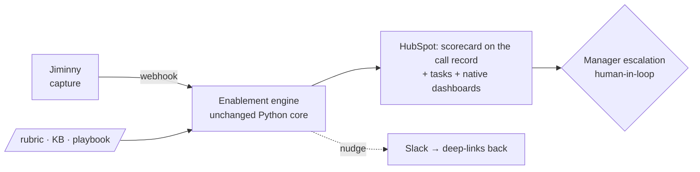

# Scalability & Production Readiness

## Running Rep Coach for real — safely, and without me

**Janos Kristof** · GTM AI Enablement · *prepared under NDA, call data anonymized*

The three questions after the demo: **how does it trigger, how does data stay safe, how does it keep
running long after I've moved on?**

---

## Productionizing is integration, not reconstruction

The differentiator already runs and is tested. What's mocked is the plumbing — and each mock sits
behind an interface, so the swap is wiring.

| Concern | Prototype | Production |
|---------|-----------|------------|
| Trigger | Manual Process button | Jiminny call-complete webhook |
| Scoring core | Real (`scoring.py`) | **Unchanged** |
| Routing | Mock adapters → local log | Slack / HubSpot behind the same seam |
| Surface | Streamlit | **HubSpot** — card + tasks + dashboards |
| LLM | Synthetic text only | Zero-retention **BAA** endpoint |

---

## Orchestration — decided, with reasoning

**Keep the scoring core in code** (testable, prompt-versioned, golden-check). **Use the lightest
orchestration that clears NDA/data-residency.**

- **HubSpot Workflows / Operations Hub + a thin service — test first.** No new vendor; data stays in
  one place (HubSpot is the confirmed CRM).
- **Self-hosted n8n — the fallback when complexity grows** (many triggers/teams/rubrics, branching
  human-in-loop, retries at scale). Self-hostable = NDA-friendly.
- **Not locked in or out:** the adapter seam makes adopting a platform a **glue change, not a
  rewrite.** Re-implementing scoring in workflow nodes is the anti-pattern — it throws away the tests.

---

## HubSpot as the single surface — kills the tool-jump (pain #1)

Scorecard **on the call record**, follow-ups as **tasks** (prospect + rep-coaching), trends as
**native dashboards**. Slack nudges deep-link back. Reps/managers stop tool-jumping.

---

## Data safety — the NDA + HIPAA posture

Senior-care data is confidential and HIPAA-adjacent. This layer is non-negotiable.

- **LLM** — zero-retention endpoint with a **BAA** (Anthropic / Bedrock / Azure), in-region. *No real
  PII has left the machine — the prototype sends only synthetic text.*
- **PII** — in-region, optional pre-LLM redaction, encrypted in transit + at rest.
- **RBAC** — rep sees own, manager sees team; inherited from HubSpot.
- **Audit** — every eval stamps `rubric_version` + `model` → reproducible, attributable.

---

## Cost & "runs without me"

**Cost is not the software.** ~cents per call (LLM); ~$40–200/mo at 2,000 calls; HubSpot tier is the
only material line (priced in discovery). The dominant cost is human — keeping the rubric + KB
current — which the tool exists to *reduce*.

**Runs without me:**
- Versioned rubric · config-over-code (a new team = a new YAML, proven by AC8)
- Structured-output health monitoring + an error queue (nothing silently dropped)
- One-command deploy / re-score; no bespoke infra to babysit

---

## The through-line

> **Productionizing Rep Coach is integration and governance, not reconstruction.**

The differentiator already runs and is tested. Production = wire the real trigger, swap the mock
adapters for HubSpot/Slack behind the seam built for it, and add the NDA/HIPAA + operational
guardrails. **Human keeps the judgment; the loop does the mechanical.** That's how one good loop
becomes safe, single-surfaced, and durable — the work a real enablement lead does.
